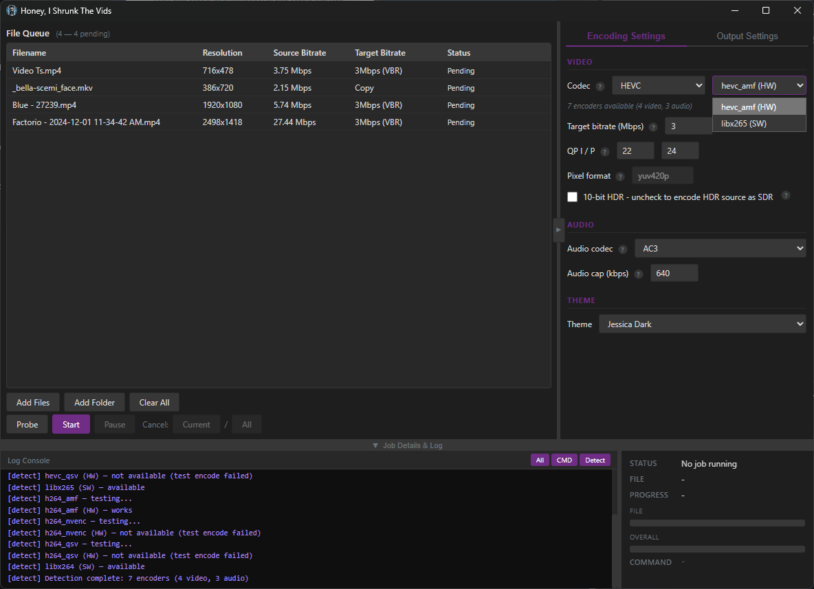
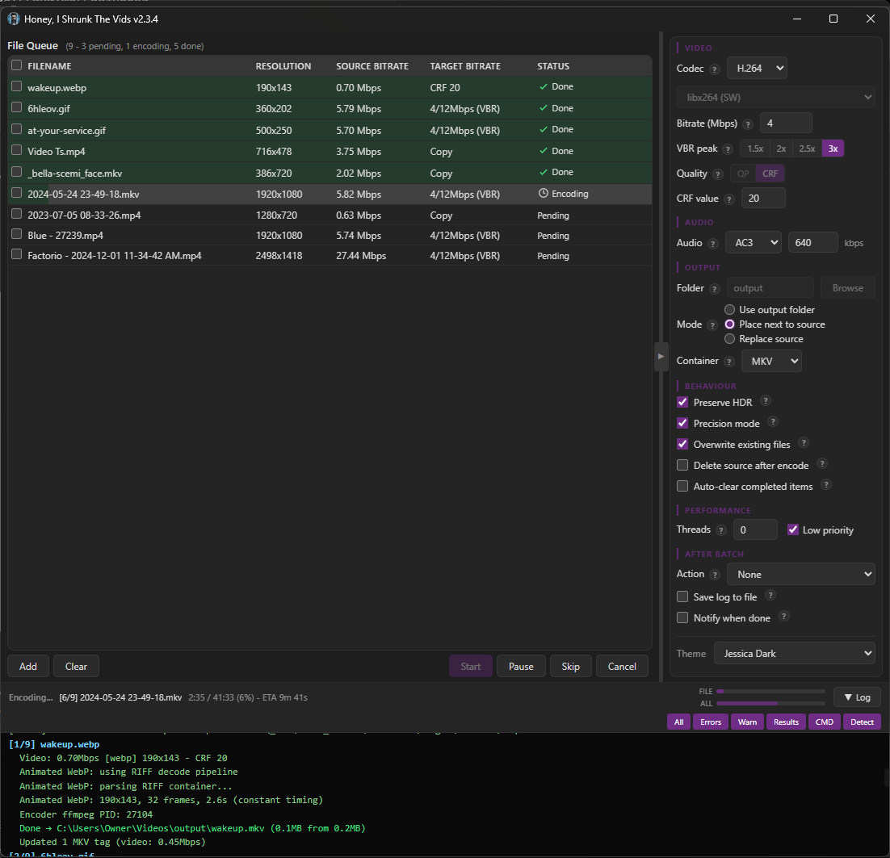
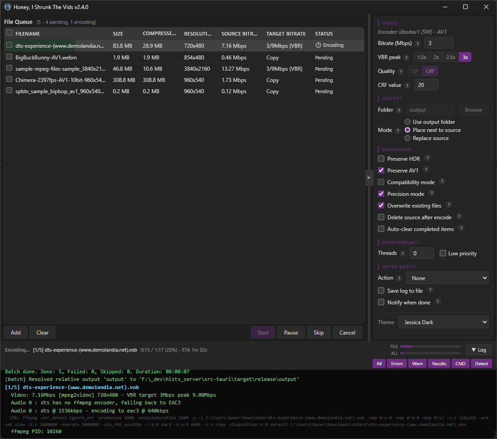
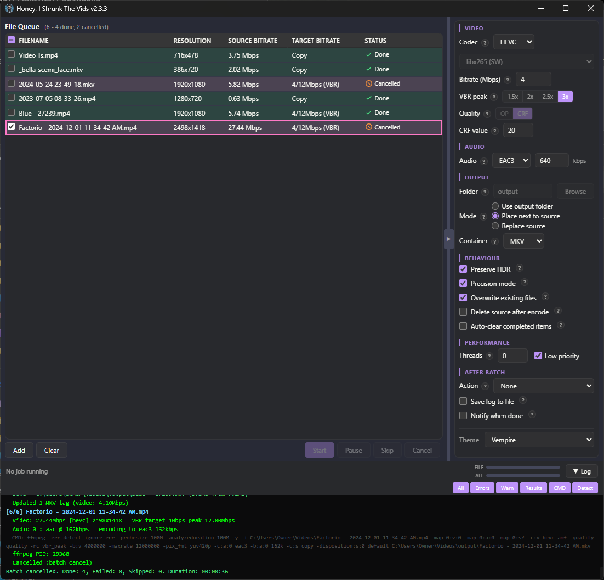
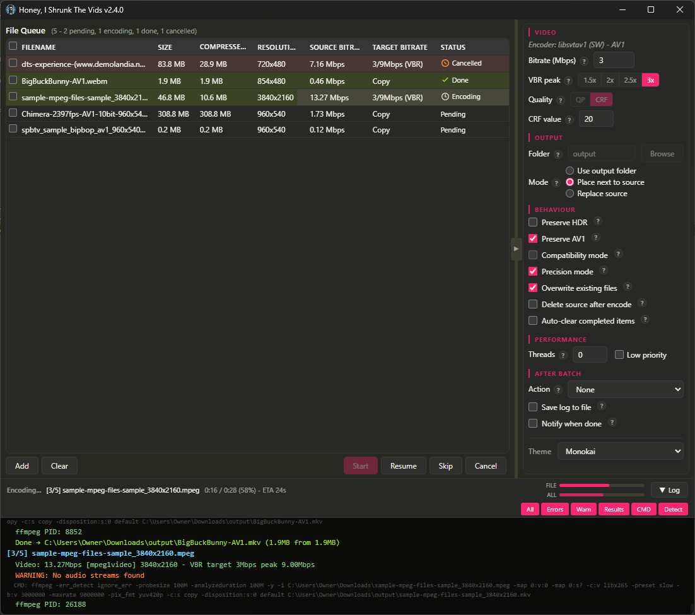
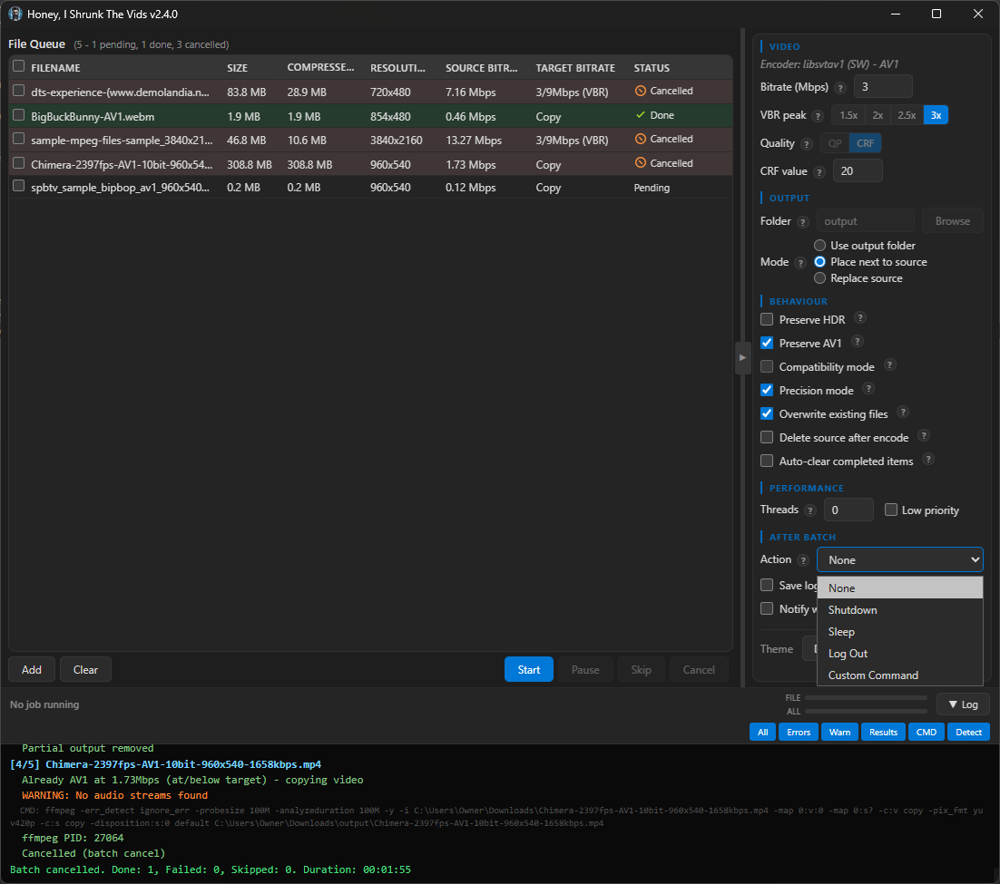
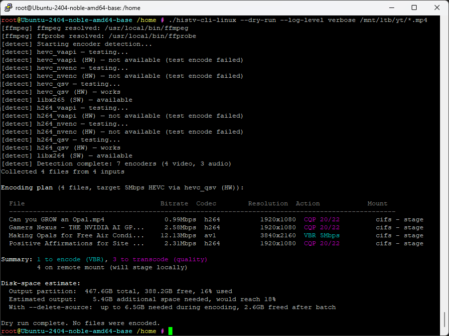
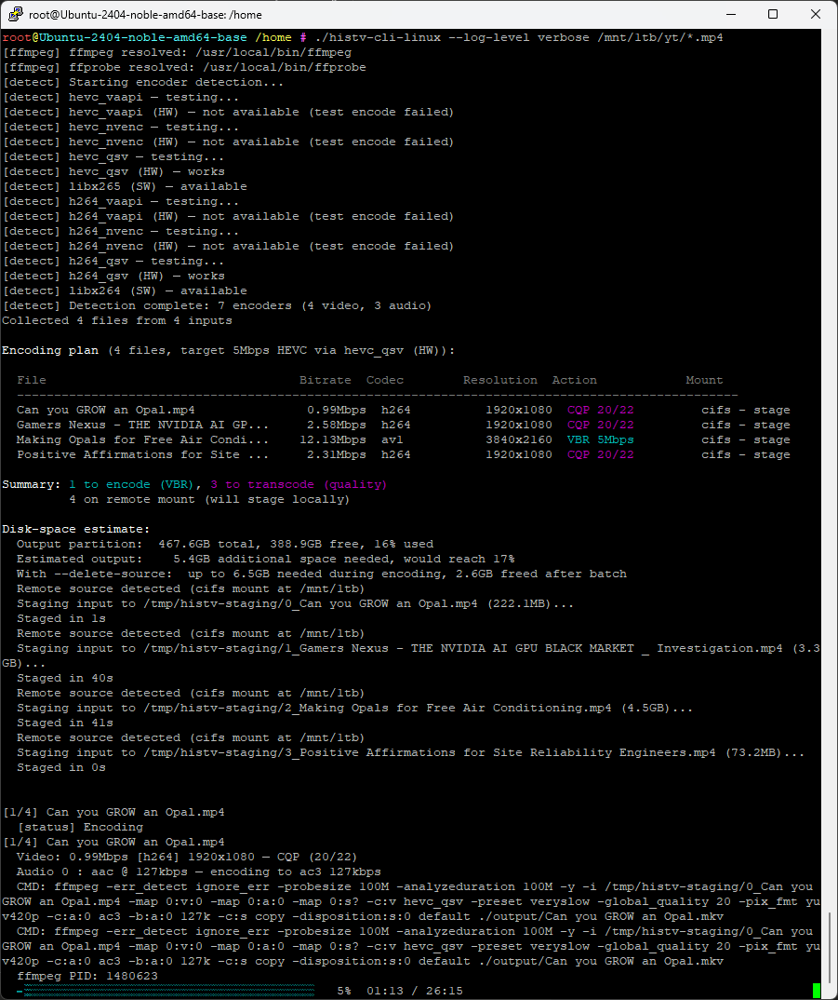
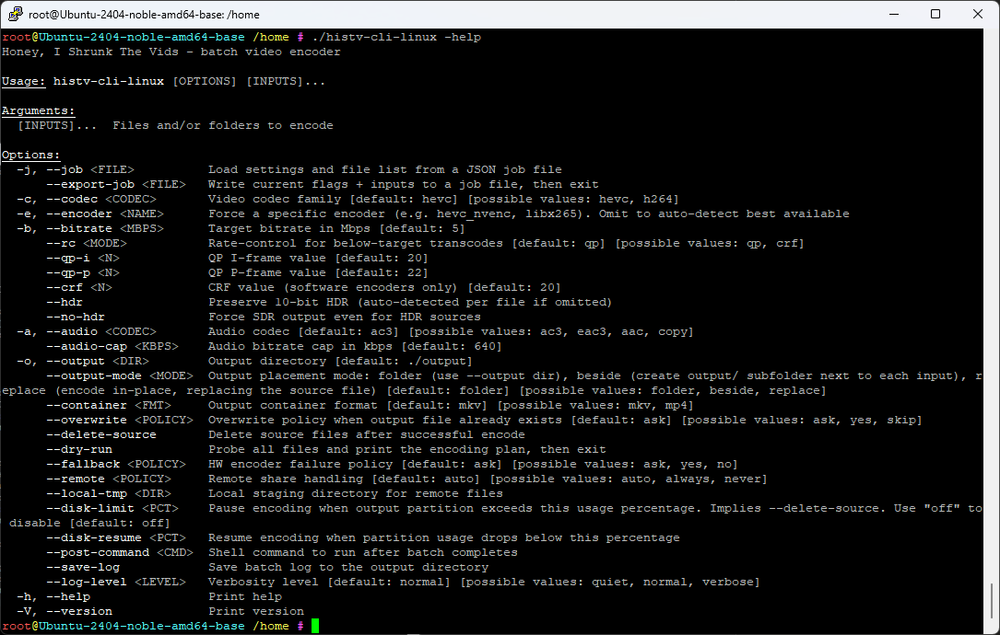

# Honey, I Shrunk The Vids

[](https://github.com/qainsights/quillx) Architecture, integration decisions, and review are mine. Claude generated the implementation under close direction. Output reviewed line by line (but that doesn't mean I caught everything).

> **Branch status.** This is `3.0.0-dev`, the long-lived integration branch for HISTV 3.0. `main` stays on the stable 2.x line. 3.0 is promoted to `main` only as an official release, after extensive testing on Linux and at least some testing on Windows and macOS. Stable builds are on the [Releases page](https://github.com/obelisk-complex/histv-universal/releases); this branch is built from source (see "Building from source" under Download). The Doublet and Classic style switch has been checked in headless Chromium only; checks on the real WebKitGTK and WebView2 engines are part of the pre-3.0 testing.

A cross-platform batch video encoder that shrinks your video files to a target quality level. No need to babysit the queue or tweak settings per file - just pick a target bitrate, add your files, and hit start.

Available as a desktop app and a headless CLI for servers (see [CLI-README.md](CLI-README.md)) The CLI can be used with Sonarr/Radarr via Custom Script; please see the [Sonarr-Radarr Guide](Sonarr-Radarr-Integration.md) for details. Both GUI and CLI use the same encoding engine for compatibility and maintainability. Portable binaries are on the GitHub [Releases page](https://github.com/obelisk-complex/histv-universal/releases).

---

### Screenshots
<details>



















</details>

## What is new in 3.0.0-dev

Changes on this branch that the 2.x line on `main` does not have.

- **Choose your look: Doublet or Classic.** Doublet is the new interface. Classic brings back the colours, glass effects and proportions from before the Doublet refresh, for anyone who prefers them. It runs on the current layout code, so the new wording and the rail and splitter fixes apply in both. Pick one with Style, next to Theme: it applies at once, without a restart, and is remembered. Switching style does not change your theme, and labels and messages use the same words in both. Classic drops the first part of some headings (such as "Advanced /"), and Doublet adds a symbol before warning, error and result lines in the log. If the other style's stylesheets fail to load, the current style stays and the log says so.
- **Classic Dark and Classic Light themes.** Two extra built-in themes hold the colours Default Dark and Default Light had before Doublet. They work under either style.
- **Dolby Vision profile 5 files that would come out wrong now say so.** With neither MP4Box nor an ffmpeg that can write Dolby Vision, profile 5 is written as plain HDR10, which probably gives wrong colours. The pre-flight check, the CLI dry run and the encode log name the way out: install MP4Box, or use HISTV's own ffmpeg.
- **More GPUs can encode.** Vulkan encoders (HEVC and H.264, on Linux and Windows) and Direct3D 12 encoders (Windows) are used when the vendor encoders (VAAPI, NVENC, QSV, AMF) are not available. Each is checked with a test encode at start-up. On Linux machines with two GPUs, HISTV uses the lowest render node, and the Intel one for QSV.
- **The CLI uses your GPU too.** Auto mode now picks the same hardware encoder as the GUI, per file and per codec family. It used to stay on software.
- **Dolby Vision needs fewer extra tools.** ffmpeg writes the Dolby Vision data itself for profile 5 and 8 sources, so audio of any codec, subtitles and MKV output all survive, and MP4Box is only needed for profile 7, when a hardware encoder is kept, or when your ffmpeg cannot write Dolby Vision itself (HISTV's own build can). Profile 5 stays profile 5 on that route. A profile 7 source is now written as profile 8.1, because the output has no enhancement layer. See [Dolby Vision and HDR10+](#dolby-vision-and-hdr10).
- **HDR10+ is found and kept.** HDR10+ sources are detected from the first frame, libx265 writes the dynamic metadata itself, and hardware HEVC encoders get it injected afterwards. Where it cannot be kept with the encoder auto mode picks, the pre-flight check and the CLI dry run say so before you start, and the log always says why.
- **Every source frame is kept.** Video re-encodes no longer duplicate or drop frames, so Dolby Vision and HDR10+ metadata stays lined up with its pictures.
- **Ubuntu's ffmpeg 6.1 works with `hevc_vaapi`,** and HEVC from VAAPI now has the right frame size instead of coming out padded or a few rows short.
- **Animated GIF, APNG and WebP work with a forced hardware encoder.** APNG files now report their duration, which they previously failed to.
- **ffmpeg is HISTV's own build.** The `-full` builds and the Flatpak bundle ffmpeg n8.1.3 (release `ffmpeg-n8.1.3-histv.2`), and the in-app downloader fetches it first and checks its SHA-256.
- **The encoder summary matches what will happen.** It follows each file's codec family, so H.264 sources show H.264 and a mixed queue lists every encoder in use.
- **Start-up log lines reach the log panel,** including the encoder detection results, which the panel used to miss.
- **The CLI no longer panics on non-ASCII file names** in the dry-run table and the live display.

## Features

<details>
<summary><strong>Full feature list</strong></summary>

- **Queue management** - drag-and-drop, clipboard paste (Ctrl+V), file/folder picker. Click, Shift+click, Ctrl+click, Ctrl+A, Delete. Right-click context menu (also Shift+F10 for keyboard users). Drag to reorder.
- **GIF/APNG/WebP support** - animated GIFs, APNGs, and WebPs are converted to proper video files automatically.
- **Per-file codec resolution** - the app decides the codec, container, and audio handling for each file individually based on its source properties. H.264 stays H.264, HEVC stays HEVC, and everything else converts to HEVC. No manual codec selection needed.
- **AV1 support** - first-class AV1 encoding via libsvtav1 and hardware AV1 encoders where your ffmpeg offers them (AMF, NVENC, QSV, D3D12 and VAAPI are tried, and VideoToolbox on macOS). Enable Preserve AV1 to keep AV1 sources as AV1 instead of converting to HEVC.
- **Compatibility Mode** - one checkbox to force H.264/MP4/AAC output for maximum device compatibility.
- **Smart decisions** - the app figures out what to do with each file before you start. Files that are already small enough get copied untouched. Files that are too big get shrunk. The queue shows the plan in real time as you change settings.
- **GPU encoding** - tests your GPU at startup and uses the first working hardware encoder for each codec family (HEVC, H.264, AV1), vendor encoders first. If the GPU encoder fails as a file starts, the app offers to retry it in software (the CLI retries without asking when it is not run in a terminal).
- **QP / CRF quality modes** - two ways to control quality when files are below your target bitrate. QP gives predictable sizes; CRF gives better-looking results with less predictable sizes.
- **Precision mode** - one checkbox for the best possible quality. Uses software encoding with smart analysis that adapts to your system's RAM. Tests a few short clips first to make sure it won't make the file bigger. Slower, but produces the smallest file that still looks great.
- **VBR peak ceiling** - controls how much the bitrate can spike on action-heavy scenes (1.5x to 4x). Higher values look better on complex content.
- **Audio handling** - each audio track is handled separately. Tracks already below 640kbps are copied as-is. Tracks above the cap are re-encoded to the same codec at the cap. Codecs with no ffmpeg encoder (DTS, TrueHD) fall back to EAC3. Compatibility Mode forces AAC.
- **HDR support** - HDR videos are detected automatically and encoded in 10-bit. Dolby Vision and HDR10+ dynamic metadata are preserved automatically when the encoder and ffmpeg allow it (the app offers to download MP4Box when DV packaging needs it). When preservation isn't possible, the app falls back gracefully to HDR10 and tells you why. Untick the HDR checkbox to convert HDR to SDR with industry-standard tonemapping so colours look right on a normal screen.
- **Pre-flight checks** - before encoding starts, the app scans your queue and warns you if any files won't get their best-possible encode (e.g. DV profile 7 files without MP4Box, or HDR10+ files whose encoder can't keep the metadata). Offers to download missing tools, encode anyway, or cancel.
- **Subtitles** - all subtitle tracks are kept.
- **Output options** - save to a folder, next to the source file, or replace the source. Container is preserved per-file (MKV stays MKV, MP4 stays MP4, MOV stays MOV; other formats default to MKV).
- **Queue columns** - source file size, estimated compressed size, resolution, HDR type badge (DV8, HDR10+, HDR10, HLG, SDR), source and target bitrates, and resizable column headers.
- **Size safety net** - if the encoded file ends up meaningfully bigger than the original (accounting for container overhead based on frame rate and audio streams), the app throws it away and copies the original into the new container instead. Files already below the target threshold are copied without re-encoding.
- **MKV tag repair** - detects and corrects stale stream statistics tags left behind by ffmpeg and third-party muxing tools, so bitrate decisions use the real numbers. Runs automatically at import and after each encode, with optional manual deep repair for severely corrupted metadata.
- **Performance controls** - limit CPU threads and/or run encoding at low priority so your PC stays usable.
- **ETA** - shows estimated time remaining in the progress bar and the window title, so you can see it from the taskbar.
- **Batch controls** - start, pause, cancel current file, cancel everything. Progress bars per file and overall. Files added mid-batch are picked up automatically.
- **Dry run** - shows what the app would do without actually encoding anything.
- **Network drive support** - detects files on network shares and stages them locally in waves before encoding, so slow networks don't bottleneck the encoder. Wave planning groups files to fit available staging space, stages an entire wave at once, encodes, cleans up, and repeats.
- **Disk space monitoring** - pauses encoding if your drive gets too full, resumes when space frees up.
- **Post-batch actions** - shut down, sleep, log out, or run a custom command when the batch finishes.
- **Log console** - colour-coded log with filters, optional file export.
- **Notifications** - system notification when the batch finishes.
- **Auto-clear** - optionally clears finished items from the queue.
- **Flatpak support** - available as a Flatpak bundle for Linux with host filesystem access so ffmpeg subprocesses can reach your files directly.
- **Themes** - fourteen built-in themes: four Doublet pairings (Doublet, Doublet Dusk, Doublet Ember, Doublet Filigree), Default Dark, Default Light, Classic Dark, Classic Light, and six more palettes (Jessica Dark, Solarised Dark, Nord, Vempire, Creditor, Monokai). Create your own with just 6 colour values - the app derives everything else automatically. See [THEMES.md](THEMES.md).
- **ffmpeg downloader** - offers to download ffmpeg for you if it's not installed. It fetches HISTV's own ffmpeg build first and checks it against a pinned SHA-256 before using it. If that download fails, it falls back to third-party static builds, which are not checksum-verified. A downloaded copy is used ahead of an ffmpeg in a system folder such as `/usr/bin`.
- **Remembers settings** - everything is saved to config.json in the same folder as the .exe, and restored on next launch.
- **CLI version** - same engine as a command-line tool for servers and scripts. Shows a persistent queue table during encoding matching the GUI's columns. See [CLI-README.md](CLI-README.md).

</details>

## Download

Grab the latest build from the GitHub **[Releases page](https://github.com/obelisk-complex/histv-universal/releases)**.

Each platform has a standard build (you provide ffmpeg) and a **-full** build (ffmpeg included). The full builds are larger but work out of the box with no extra setup.

**Standard builds** - ffmpeg not included:

| Platform | GUI | CLI |
|----------|-----|-----|
| **Windows** | `histv-windows.exe` | `histv-cli-windows.exe` |
| **Linux** | `.AppImage` | `histv-cli-linux` |
| **macOS (Apple Silicon)** | `.dmg` (arm64) | `histv-cli-macos-arm64` |
| **macOS (Intel)** | `.dmg` (x64) | `histv-cli-macos-x64` |

**Full builds** - ffmpeg included, no extra dependencies:

| Platform | GUI | CLI |
|----------|-----|-----|
| **Windows** | `histv-windows-full.zip` | `histv-cli-windows-full.zip` |
| **Linux** | `histv-linux-full.AppImage` | `histv-cli-linux-full.tar.gz` |
| **macOS (Apple Silicon)** | `histv-macos-arm64-full.dmg` | `histv-cli-macos-arm64-full.tar.gz` |
| **macOS (Intel)** | `histv-macos-x64-full.dmg` | `histv-cli-macos-x64-full.tar.gz` |

**Flatpak** - sandboxed Linux build with ffmpeg included:

| Platform | GUI |
|----------|-----|
| **Linux** | `histv-linux.flatpak` |

The Flatpak bundles ffmpeg and has host filesystem access for encoding. The CLI is not included in the Flatpak.

All binaries are portable - no installation needed. On Linux, mark the AppImage executable (`chmod +x`). On macOS, open the DMG and drag to Applications. On Windows, extract the zip to a folder.

<details>
<summary><strong>Linux display troubleshooting</strong></summary>

HISTV sets three environment variables before GTK initialises to work around WebKitGTK rendering issues on Wayland. These are only set if you haven't already set them yourself:

| Variable | Default | What it does |
|----------|---------|-------------|
| `WEBKIT_DISABLE_DMABUF_RENDERER` | `1` | Disables DMA-buf buffer sharing. Fixes `EGL_BAD_PARAMETER` and GBM buffer failures on AMD RDNA3+, some Intel iGPUs, and NVIDIA with Wayland. |
| `WEBKIT_DISABLE_COMPOSITING_MODE` | `1` | Disables GPU compositing entirely. Catches EGL display creation failures that the DMA-buf fix alone doesn't cover. |
| `__NV_DISABLE_EXPLICIT_SYNC` | `1` | Disables NVIDIA explicit sync. Fixes blank/flickering windows on NVIDIA 545+ drivers with Wayland. |

If your system handles Wayland rendering correctly and you want GPU compositing back, override any of these before launching:

```bash
WEBKIT_DISABLE_COMPOSITING_MODE=0 WEBKIT_DISABLE_DMABUF_RENDERER=0 ./histv
```

The Flatpak respects these overrides via `flatpak run --env=VARIABLE=VALUE com.histv.encoder` or by setting them in your shell before `flatpak run`.

</details>

If you use a standard build, ffmpeg is required. The GUI offers to download it on first launch. The CLI expects it on your PATH (`apt install ffmpeg`, `brew install ffmpeg`, `choco install ffmpeg`, etc.).

| OS | Architecture | GPU encoders |
|----|-------------|-------------|
| Windows | x86_64 | AMF, NVENC, QSV, D3D12, Vulkan |
| Linux | x86_64 | VAAPI, NVENC, QSV, Vulkan |
| macOS | x86_64 / ARM64 | VideoToolbox |

Hardware encoder detection covers HEVC, H.264, and AV1 codec families, and keeps an encoder only if your ffmpeg lists it and a test encode succeeds. Vulkan is used for HEVC and H.264 only. Encoders are tried in the order shown, and each is verified with a test encode at startup.

HISTV looks for ffmpeg beside the app first, then in the folder its own downloader uses, then in common install folders (Homebrew, Chocolatey, snap and similar) and on your PATH. A system folder such as `/usr/bin` beside a packaged HISTV does not count as "beside the app", so a downloaded ffmpeg wins over the system one.

<details>
<summary><strong>Building from source</strong></summary>

Requires Rust (stable) and the Tauri v2 CLI. See the [Tauri prerequisites guide](https://v2.tauri.app/start/prerequisites/) for platform-specific dependencies.

```bash
# GUI
cargo install tauri-cli --version "^2"
cargo tauri build

# CLI (no GUI/Tauri/WebKit dependencies)
cargo build --manifest-path src-tauri/Cargo.toml --release --bin histv-cli --no-default-features --features cli
```

**Cargo features:**

| Feature | Default | What it gates |
|---------|---------|---------------|
| `custom-protocol` | GUI | Tauri custom-protocol handler (required for release GUI builds) |
| `downloader` | GUI | In-app ffmpeg downloader (pulls in `reqwest` + `futures-util`); GUI-only; the CLI expects ffmpeg on your PATH |
| `dovi` | GUI, CLI | Dolby Vision RPU preservation and HDR10+ pipelines |
| `cli` | CLI | Builds the headless `histv-cli` binary without any Tauri/GTK/WebKit dependencies |

</details>

## How it works

You set a target bitrate and the app decides what to do with each file:

| Situation | What happens |
|-----------|-------------|
| Already small enough, same codec family | **Copied as-is** - no re-encoding |
| Already small enough, different codec | **Re-encoded for quality** using QP or CRF into the target codec |
| Too big | **Shrunk** to hit the target bitrate using VBR encoding |
| Zero bitrate / unreadable header | **Re-encoded for quality** using QP or CRF |
| GIF, APNG, or animated WebP | **Always re-encoded** into a proper video |

The target codec is determined per-file: H.264 sources stay H.264, HEVC sources stay HEVC, and everything else (MPEG-2, VP9, etc.) converts to HEVC. With Preserve AV1 enabled, AV1 sources stay AV1. With Compatibility Mode, everything becomes H.264/MP4.

Files within 15% above the threshold that are already in the target codec are also copied rather than re-encoded, to avoid wasting time on marginal gains.

If an encode makes the file meaningfully bigger than it was (accounting for container overhead), the app throws away the encode and copies the original into the new container instead. Small size increases from container format differences are tolerated.

### Dolby Vision and HDR10+

When "Preserve HDR" is ticked, the app detects Dolby Vision and HDR10+ content and keeps the dynamic metadata through re-encoding. No extra settings needed: the app picks the route for each file from the encoder that will run, your ffmpeg and the tools it finds.

| Source | Encoder | Tools needed | Result |
|--------|---------|--------------|--------|
| Dolby Vision profile 5 or 8 | libx265 (software HEVC) | An ffmpeg with native Dolby Vision coding (HISTV's own build has it) | ffmpeg writes the Dolby Vision data itself. Audio, subtitles and the MKV container are kept. Profile 5 stays profile 5. HDR10+ is kept too if the source has both. |
| Dolby Vision profile 8 or 10, AV1 output | libsvtav1 | Native Dolby Vision coding in ffmpeg | Same as above, in AV1, except that HDR10+ is not kept (HISTV keeps HDR10+ in HEVC output only). |
| Dolby Vision profile 5, 7 or 8 | A hardware HEVC encoder | MP4Box | The hardware encoder is kept and the output is MP4. Profile 5 and 7 are written as profile 8.1. HDR10+ is not kept. Without MP4Box, profile 5 and 8 switch to libx265 as above. |
| Dolby Vision profile 7, or profile 5 or 8 with an ffmpeg that lacks native coding | Any | MP4Box | Output is MP4. Profile 5 and 7 are written as profile 8.1. Without MP4Box, profile 7 and 8 fall back to their base layer (HDR10 for the usual 7.6 and 8.1). Profile 5 has no HDR10 base layer, so its fallback does not look right (see below). |
| HDR10+ | libx265 | An ffmpeg whose libx265 can write HDR10+ (HISTV's own build can) | libx265 writes the dynamic metadata when it is HDR10+ profile A or B. Other HDR10+ metadata leaves static HDR10, and the log says why. |
| HDR10+ | A hardware HEVC encoder | None | The metadata is injected after encoding, and B-frames are turned off for that encode. |
| HDR10+ | `hevc_vaapi` with ffmpeg older than 7 | None | Static HDR10 only: that ffmpeg's demuxer mis-orders the stream's parameter sets. |
| HDR10+ | H.264 or AV1 output | None | Static HDR10 only: HDR10+ is kept in HEVC output only. |
| HDR10 / HLG | Any | None | Preserved as-is. |

On Linux, a VAAPI encoder is replaced by libx265 for Dolby Vision because AMD 10-bit VAAPI HEVC produced visible artefacts. Setting `HISTV_ALLOW_VAAPI_DV=1` keeps VAAPI for testing the MP4Box route.

When HDR10+ cannot be kept, the log says "Static HDR10 only" with the reason, and the pre-flight check (GUI) and dry run (CLI) warn before encoding starts. If a hardware encode fails and the software fallback runs, the route is decided again for libx265.

Known limitation: a Dolby Vision profile 5 file converted with neither MP4Box nor an ffmpeg that can write Dolby Vision is encoded as plain HDR10. Profile 5 has no HDR10 base layer, so the result probably does not play back with correct colours. The pre-flight check, the CLI dry run and the encode log now say so for these files. Install MP4Box or use HISTV's own ffmpeg build to avoid it.

The bitstream is read from disk in a stream, so memory use grows with the number of frames (a few hundred bytes of metadata each), not with file size. If a DV/HDR10+ pipeline step fails, the app falls back to the next best option and logs why.

### Precision mode

One checkbox for the best quality the app can produce. It picks the smartest encoding strategy based on how much RAM your system has:

| Your RAM | What it does |
|----------|-------------|
| 16GB or more | Looks 250 frames ahead to plan bitrate (single pass) |
| 8-16GB | Looks 120 frames ahead to plan bitrate (single pass) |
| Under 8GB | Scans the whole file first, then encodes (two passes) |

Before starting the full encode, it tests a few short clips to make sure the result won't end up bigger than the original. If it would, the app switches to a safer mode automatically.

### Who HISTV is for

People with a pile of video files at different sizes and formats who want to shrink the big ones without fiddling with every file individually. Set the target, add the files, walk away.

### How HISTV compares to other tools
<details>

**vs. HandBrake** - HandBrake is built for tweaking every file individually. HISTV is built for doing a whole folder at once without thinking about it. It figures out per-file whether to shrink, copy, or re-encode. If you want fine control over every setting on every file, HandBrake is the better tool.

**vs. Tdarr** - Tdarr runs as a server with plugins, Docker, and a web dashboard. HISTV is an app you open, use, and close.

**vs. writing your own ffmpeg script** - HISTV handles the parts that are annoying to script: figuring out what each file needs, picking the right encoder, falling back when hardware fails, prompting for overwrites, pausing/resuming, and cleaning up after itself.

</details>

<details>
<summary><strong>Project structure</strong></summary>

```
├── src/                        # Frontend (HTML + CSS + JS)
│   ├── index.html
│   ├── js/
│   │   ├── app.js
│   │   ├── ui-style.js         # Doublet / Classic style: first paint and live switch
│   │   ├── lib.js              # Pure helpers shared with app.js
│   │   └── lib.test.js         # Unit tests for lib.js
│   └── css/
│       ├── app.css             # Doublet style
│       ├── app-classic.css     # Classic style
│       ├── doublet-tokens.css  # Vendored Doublet design tokens
│       └── doublet-components.css  # Vendored Doublet components
├── src-tauri/
│   ├── Cargo.toml
│   ├── tauri.conf.json
│   ├── build.rs
│   ├── capabilities/           # Tauri permissions
│   ├── icons/
│   ├── themes/                 # Built-in theme JSON files (10)
│   ├── tests/                  # Integration tests and fixtures
│   └── src/
│       ├── main.rs             # GUI entry point
│       ├── cli_main.rs         # CLI entry point
│       ├── lib.rs              # Tauri commands, app setup, shared state
│       ├── encoder.rs          # Encoder detection, routing, flag mapping, batch loop
│       ├── ffmpeg.rs           # Binary resolution, download, spawning
│       ├── probe.rs            # Media probing via ffprobe (DV/HDR10+ detection)
│       ├── queue.rs            # Queue data structures, file collection
│       ├── dovi_pipeline.rs    # Dolby Vision RPU extract/inject pipeline
│       ├── dovi_tools.rs       # MP4Box discovery, download, capabilities
│       ├── hdr10plus_pipeline.rs  # HDR10+ metadata extract/inject pipeline
│       ├── hevc_utils.rs       # Streaming HEVC NAL reader/writer
│       ├── mkv_tags.rs         # MKV stream statistics tag repair (EBML)
│       ├── webp_decode.rs      # Animated WebP RIFF parser + decode pipeline
│       ├── events.rs           # EventSink + BatchControl traits, start-up log buffer
│       ├── config.rs           # GUI persistent settings
│       ├── themes.rs           # Theme loading + built-in themes
│       ├── tauri_sink.rs       # GUI EventSink (Tauri emit)
│       ├── tauri_batch_control.rs  # GUI BatchControl (Mutex + emit)
│       ├── cli.rs              # CLI arg parsing (clap) + job files
│       ├── cli_sink.rs         # CLI EventSink (stderr + indicatif)
│       ├── batch_control.rs    # CLI BatchControl (atomics + TTY prompts)
│       ├── remote.rs           # Network mount detection + caching
│       ├── staging.rs          # Wave-based local staging for remote files
│       ├── disk_monitor.rs     # Disk-space estimation + runtime monitoring
│       └── test_helpers.rs     # Mock sinks and factories for tests
├── tools/
│   ├── ffmpeg/                 # Build, pin and verify HISTV's ffmpeg
│   │   ├── fetch.sh            # Fetch a pinned source
│   │   ├── package.sh          # Package a verified ffmpeg/ffprobe pair
│   │   ├── verify.sh           # Conformance check for a built pair
│   │   ├── check-pins.sh       # Keep the ffmpeg tag and sha256 pins in step
│   │   ├── run-job-in-docker.sh  # Run a build-ffmpeg.yml job locally
│   │   └── e2e/                # Hand-run end-to-end harness (see its README)
│   ├── ui-harness/             # Headless Chromium checks for the style switch (see its README)
│   ├── dv-compare/             # Did the Dolby Vision data and the picture survive a transcode? (see its README)
│   └── generate-cargo-sources.py  # cargo-sources.json for the Flatpak
├── .github/workflows/
│   ├── ci.yml                  # Tests, macOS/Windows compile checks, ffmpeg pin check, dependency audit
│   ├── build-ffmpeg.yml        # Builds and publishes the ffmpeg archives
│   ├── build-platform.yml      # Per-platform app build (reusable)
│   ├── build-flatpak.yml       # Flatpak build
│   ├── build-preview.yml       # Preview build of a branch
│   └── release.yml             # Release build on publish
├── com.histv.encoder.yml       # Flatpak manifest
├── com.histv.encoder.desktop
├── com.histv.encoder.metainfo.xml
├── cargo-sources.json          # Vendored crate sources for the Flatpak
├── rust-toolchain.toml
├── docs/                       # Plans and specs
├── screenshots/
├── THEMES.md                   # Theme creation guide
├── CLI-README.md               # CLI documentation
├── Sonarr-Radarr-Integration.md
├── THIRD-PARTY-LICENCES
├── LICENSE
└── README.md
```

</details>

### Licence

[GPL-3.0-or-later](LICENSE)

### Third-party software

The **-full** builds bundle [FFmpeg](https://ffmpeg.org) n8.1.3 and [MP4Box](https://gpac.io) (GPAC). The bundled ffmpeg and ffprobe are HISTV's own static builds, compiled from unmodified upstream source with `--enable-gpl --enable-version3` and linked against GPL libraries (x264, x265), so they are distributed under the [GNU General Public Licence v3+](https://www.gnu.org/licenses/gpl-3.0.html). They also contain SVT-AV1, dav1d, zimg, Opus, libogg, libvorbis and LAME (LGPL v2+), plus libva, libdrm, zlib and libvpl on Linux; every component and its licence is listed in [THIRD-PARTY-LICENCES](THIRD-PARTY-LICENCES). MP4Box is licensed under the [GNU Lesser General Public Licence v2.1+](https://www.gnu.org/licenses/old-licenses/lgpl-2.1.html).

The corresponding source is the upstream source at the versions pinned in [`build-ffmpeg.yml`](.github/workflows/build-ffmpeg.yml), which is also the build recipe. Each archive ships a `BUILDINFO.txt` with every source pin and the exact configure line, and the archives are published as the `ffmpeg-*` [releases](https://github.com/obelisk-complex/histv-universal/releases). We will also provide the source on request for three years from the date of each release - file an issue on this repo.

Dolby Vision processing uses the [dolby_vision](https://crates.io/crates/dolby_vision) crate by quietvoid (MIT). HDR10+ processing uses the [hdr10plus](https://crates.io/crates/hdr10plus) crate by quietvoid (MIT).

This software is based in part on the work of the Independent JPEG Group. See [THIRD-PARTY-LICENCES](THIRD-PARTY-LICENCES) for full details.

<details>
<summary><strong>Technical changelog</strong></summary>

Everything on `3.0.0-dev` that is not in `main`, from the commits since the branch point (`git log main..3.0.0-dev`).

#### Miscellanea

**Encoder routing** (`src-tauri/src/encoder.rs`)
- Vulkan and Direct3D 12 encoders added to the per-platform priority tables; `pick_encoder` takes the first hardware encoder in table order, and the GUI, the batch engine and the CLI share it (6d95b71). `hw_device_args` builds the device arguments for detection and real encodes alike; the lowest DRI render node is used, and an Intel node for QSV (6d95b71, 1a93ebd).
- `dovi_route`, `dovi_route_for_encoder`, `hdr10plus_route` and `hdr10plus_loss` make the Dolby Vision and HDR10+ decisions as pure functions, decided for the encoder that will run (6d95b71, 7055a8c, 1a93ebd). `fallback_sw_args` decides again for the software fallback (aedc0ad). `hevc_vaapi` on ffmpeg older than 7 returns `Err` from `hdr10plus_route` (a3d0520).
- `FfmpegCaps` is filled by a capability probe: `dovi_x265`, `dovi_svtav1`, `x265_hdr10plus`, `hevc_metadata_size`, `no_fps_mode`, `ffmpeg_major`. Hardware test encodes, the capability probe and the first-frame HDR10+ probe time out (`output_with_timeout`).
- Video encodes use `-fps_mode passthrough`, or `-vsync passthrough` before ffmpeg 5.1 (8ab98f7). `hevc_vaapi` frame size is fixed with `hevc_metadata` where it exists and by padding and cropping where it does not (98bb595, 4737543). AV1 constant quality on VAAPI and D3D12 uses `-global_quality` (1a93ebd). Profile 7 converts to 8.1 (b028a45).
- `hevc_parser` `=0.6.10` is a direct dependency behind the `dovi` feature, used by `hevc_utils.rs` to match dynamic metadata to frames in display order.

**ffmpeg handling** (`src-tauri/src/ffmpeg.rs`)
- `histv_release` pins the tag `ffmpeg-n8.1.3-histv.2` and one SHA-256 per platform; `download_urls` tries the HISTV archive first, then unverified third-party builds (4dc8bd0, 23e5c98, 17fdb38). A drop guard removes the partial archive on every failure path (2f30303), and a checksum mismatch is logged as one (5e73dad).
- `resolve_binary` skips the executable's own directory when it is a system directory (`SYSTEM_EXE_DIRS`), through `sibling_binary` (4eba290, 81cb0a8).

**Frontend and probing**
- `LogBuffer` in `events.rs` queues log lines until the `attach_log_listener` command runs; `listenTauriEvents` resolves after every listener is registered (1283d14, ab63e57, e8003ca).
- `resolveEncoderFamilies` and `resolveFamilyForCodec` in `app.js` mirror `lib.js`, and `lib.test.js` compares the two copies (422292f, 0e7ebec, c93d96e).
- `probe.rs` reads HDR10+ from the first frame's side data of PQ HEVC sources, and APNG duration from the packet span (6d95b71, 104958b). `webp_decode.rs` builds device arguments through `hw_device_args`.
- `truncate_filename` in `cli_main.rs` counts characters, not bytes (44cff31).

**Interface style** (`src/js/ui-style.js`, `src/css/app-classic.css`, `tools/ui-harness/`)
- `ui-style.js` writes `<link id="ui-style-css">` with `document.write` while `<head>` parses, from `localStorage['histv-ui-style']`, so the saved style is in the first painted frame; `app.js` applies the `uiStyle` config value once it loads. A live switch loads the new stylesheets in extra links with `media="not all"`, then swaps them, the `data-ui-style` marker and the theme derivation (`deriveDoubletTokens` or `deriveClassicTokens`) in one step; a failed load keeps the old style (a5ecc05, 9f8f202). `uiStyle` is a `config.rs` field that reads anything but `"classic"` as `"doublet"` (d37341d); `app-classic.css` is the pre-Doublet stylesheet (4689cb8); Classic Dark and Classic Light are built-in themes (a7ebf61).
- `tools/ui-harness/` drives the front end in headless Chromium (Playwright) against a mocked Tauri bridge (f94a01c), never a display. `run.sh matrix` renders style x theme x state (d919111); `parity` compares element boxes and, on mapped theme pairs, colours of Classic against the pre-Doublet commit `e4d0ee2` (b8449ba, fe2fd7c); `toggle` compares live switches with fresh loads (763e3f9); `paint` checks the persisted style in the first painted frame and `selftest` runs the negative controls that must fail (23054a4); `switch` watches every frame of a switch with slow or failing stylesheets (61fc0fe). Run by hand; no workflow calls it.
- Dolby Vision profile 5 warning: the reasons live in `encoder::dovi_loss`, shared by the pre-flight, the CLI dry run and the encode log (dc3c729).

**Build, CI and tests**
- `build-ffmpeg.yml` builds ffmpeg n8.1.3 from pinned sources (git commits and tarball SHA-256s) with Vulkan, D3D12, AMF, libvpl and x265 HDR10+, and publishes archives with `BUILDINFO.txt`, build attestations and `histv-ffmpeg-sources.tar` (0c9b880, 6298d53). `tools/ffmpeg/` holds the helper scripts; `verify.sh` gates the build, `check-pins.sh` keeps the tag and checksums in step across `ffmpeg.rs`, `build-platform.yml` and the Flatpak manifest (c5f57c9).
- Release bundles and the Flatpak ship the HISTV ffmpeg (2ff9762). `ci.yml` skips the Linux test job on pull requests, runs the pin check as its own job and audits dependencies weekly; jobs have timeouts (5e73dad, 3d90b5a).
- `tools/ffmpeg/e2e/` runs the real argument builder through `histv-cli` against synthetic sources. Last results for `ffmpeg-n8.1.3-histv.2`: 295 PASS, 0 FAIL, 10 XFAIL, 0 XPASS, 12 SKIP (f36a06a, fcc96b8; details in `tools/ffmpeg/e2e/README.md`).
- `tools/dv-compare/` compares a Dolby Vision input with its output: container and stream fields, configuration box, one RPU per frame, every RPU parsed with `dolby_vision` 3.3.2 and paired in display order, extension blocks per level, packet md5 for stream copies, full decode, PSNR/SSIM; exit 0 passed, 1 differences, 2 nothing compared, 3 tool error (29b98f7, fc109b7). `run.sh selftest` damages a synthetic clip 14 ways and each must be caught by name (ed240e4). Run by hand; no workflow calls it.
- Dependencies updated after `cargo audit` (9ad2d0e); `cargo-sources.json` regenerated for the Flatpak (b1ba3f5).

</details>
